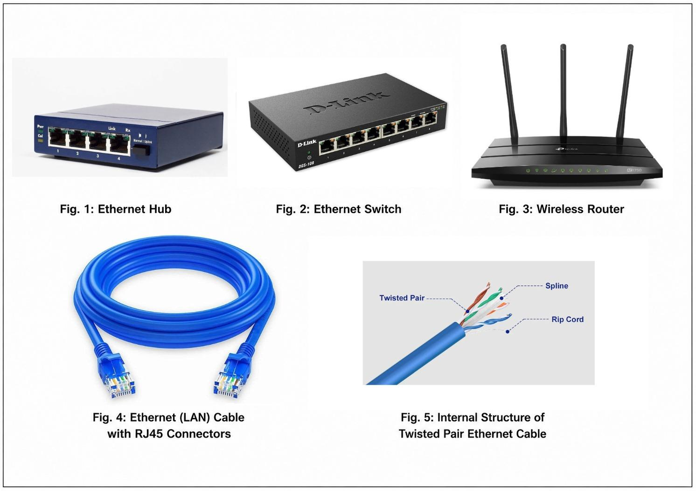

# Practical 01: Study of Basic Elements of Computer Networking & Networking Devices

## 📌 Aim
To study the basic elements of computer networking, understand network topologies, transmission media, and investigate the roles, architecture, and functions of core networking devices (Hub, Switch, Router, LAN Cables, NIC, etc.).

---

## 📖 Theory & Fundamentals

### 1. Introduction to Computer Networks
A **Computer Network** is an interconnection of two or more autonomous computing devices through transmission media and communication protocols to exchange data, share resources (printers, storage), and facilitate communication.

Key characteristics:
- **Resource Sharing**: Sharing peripheral hardware, files, and databases.
- **Scalability**: Seamless addition of new nodes without degrading network stability.
- **Reliability & Redundancy**: Alternative communication paths in case of link failure.
- **Security**: Access control and encryption across packet transmission.

---

### 2. Network Classification by Scale
| Network Type | Full Form | Typical Geographic Span | Data Rate | Example |
|---|---|---|---|---|
| **PAN** | Personal Area Network | Within 10 meters | Up to 100 Mbps | Bluetooth headphones, Zigbee |
| **LAN** | Local Area Network | Building / Campus (up to a few km) | 100 Mbps - 10 Gbps | College Lab, Office building |
| **MAN** | Metropolitan Area Network | City-wide (up to 50 km) | 100 Mbps - 1 Gbps | Cable TV network, City Wi-Fi |
| **WAN** | Wide Area Network | Country / Global | Variable (Mbps to Tbps) | The Internet |

---

### 3. Network Topologies
- **Star Topology**: All nodes connect to a central device (Hub or Switch). Easy to troubleshoot; failure of a node does not affect others, but central device failure halts the network.
- **Bus Topology**: Nodes share a single backbone cable terminated at both ends. Cost-effective but prone to collisions and entire network fails if backbone breaks.
- **Ring Topology**: Each device is connected to exactly two neighbors forming a closed loop. Predictable token passing, but a break disrupts the loop unless dual-ring is used.
- **Mesh Topology**: Devices have dedicated point-to-point links. Full mesh provides highest redundancy and fault tolerance ($n(n-1)/2$ links).
- **Hybrid Topology**: Combination of two or more topologies (e.g., Star-Bus or Star-Ring).

---

### 4. Transmission Media
1. **Guided (Wired) Media**:
   - **Twisted Pair Cable (UTP / STP)**: Pairs of insulated copper wires twisted together to reduce electromagnetic interference (EMI) and cross-talk. Commonly used with **RJ-45 connectors** (Cat5e, Cat6).
   - **Coaxial Cable**: Central copper conductor surrounded by insulating layer, metallic braided shield, and outer jacket. Used in cable television and older Ethernet (10Base2/10Base5).
   - **Fiber Optic Cable**: Transmits data as pulses of light through core glass or plastic fibers using Total Internal Reflection (TIR). Immune to EMI, exceptionally high bandwidth, and long distance transmission.
2. **Unguided (Wireless) Media**:
   - Radio waves (Omnidirectional, e.g., Wi-Fi, Cellular).
   - Microwaves (Unidirectional line-of-sight, satellite links).
   - Infrared (Short-range line-of-sight, remote controls).

---

## 🛠️ Detailed Study of Networking Devices

### 1. Network Interface Card (NIC / LAN Card)
- **Layer**: Physical & Data Link Layer (Layers 1 & 2).
- **Function**: Hardware component connecting a computer to a network. Contains a unique, hardcoded 48-bit **MAC (Media Access Control) address** represented in hexadecimal (e.g., `00:1A:2B:3C:4D:5E`).

### 2. Ethernet Hub
- **Layer**: Physical Layer (Layer 1).
- **Operation**: A non-intelligent multi-port repeater. When a packet arrives at one port, it is **broadcasted** to all other ports regardless of destination.
- **Properties**: Operates in **Half-Duplex**; all connected devices share a **single collision domain** and a **single broadcast domain**. High collision probability with increased traffic.

### 3. Ethernet Switch
- **Layer**: Data Link Layer (Layer 2) (Layer 3 switches also support routing).
- **Operation**: An intelligent device that maintains a **MAC Address Table (CAM Table)** mapping physical ports to MAC addresses.
- **Properties**: Inspects frame header and forwards packets via **Unicast** directly to the target port. Provides **dedicated bandwidth** per port, operates in **Full-Duplex**, breaks collision domains (each port is its own collision domain), but retains a single broadcast domain.

### 4. Router
- **Layer**: Network Layer (Layer 3).
- **Operation**: Interconnects different logical networks (e.g., LAN to WAN, or distinct IP subnets). Reads destination **IP addresses** and consults its **Routing Table** to choose the best path using routing protocols (RIP, OSPF, BGP).
- **Properties**: Breaks both **collision domains** and **broadcast domains**.

### 5. Repeater & Bridge
- **Repeater (Layer 1)**: Amplifies and regenerates electrical or optical signals attenuated over long distances.
- **Bridge (Layer 2)**: Filters traffic and connects two distinct LAN segments using MAC addresses.

### 6. Gateway
- **Layer**: All OSI Layers (Layers 1 - 7).
- **Function**: Translates protocols between completely dissimilar network architectures (e.g., connecting an IP network with an SNA network).

---

## 📊 Comparison: Hub vs Switch vs Router

| Feature | Ethernet Hub | Ethernet Switch | Router |
|---|---|---|---|
| **OSI Layer** | Layer 1 (Physical) | Layer 2 (Data Link) | Layer 3 (Network) |
| **Addressing Used** | None (Electrical signals) | MAC Address | IP Address |
| **Data Delivery** | Broadcast to all ports | Unicast / Multicast | Unicast / Routing |
| **Collision Domains** | Single shared domain | One per port | One per port |
| **Broadcast Domains** | Single shared domain | Single shared domain | One per interface (Breaks broadcast) |
| **Transmission Mode** | Half-Duplex | Full-Duplex | Full-Duplex |
| **Intelligence** | Passive / Non-intelligent | Intelligent (CAM table) | Highly Intelligent (Routing table) |

---

## 🖼️ Reference Diagram

The following figure illustrates the physical appearance and structure of standard networking devices and cables:

*Figure 1: Ethernet Hub (Fig 1), Ethernet Switch (Fig 2), Wireless Router (Fig 3), Ethernet LAN Cable with RJ45 (Fig 4), Internal Structure of Twisted Pair Ethernet Cable (Fig 5).*

---

## 🎯 Conclusion
In this practical, we comprehensively studied the fundamental building blocks of computer networking. We examined how layer 1 devices (Hubs, Repeaters) handle physical bit transmissions, layer 2 devices (Switches, Bridges) provide frame forwarding based on hardware MAC addresses, and layer 3 devices (Routers) enable inter-network routing using logical IP addresses.
