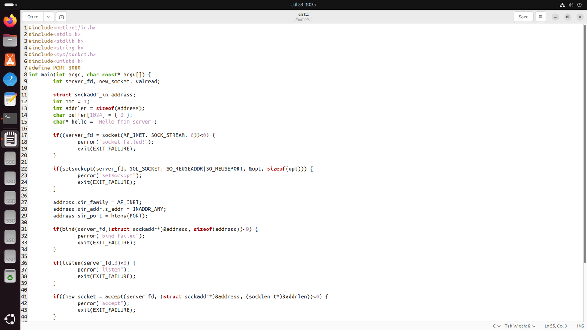
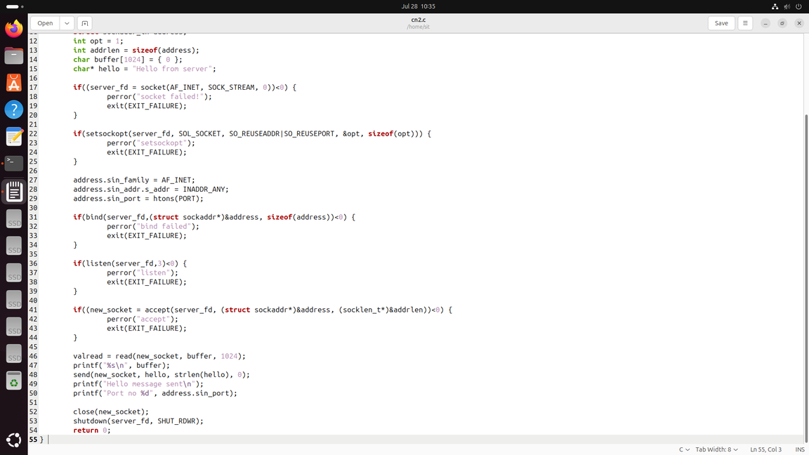
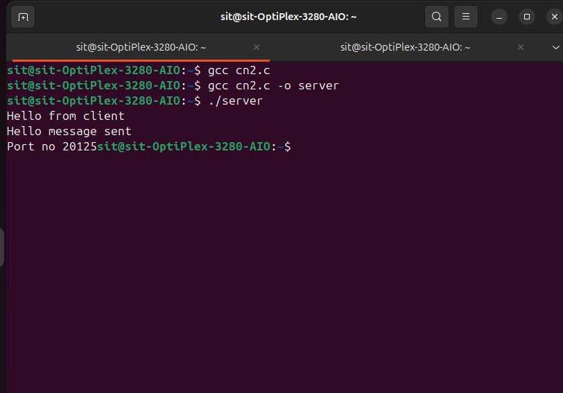

# Practical 02: Socket Programming for TCP Server

## 📌 Aim
To implement socket programming for a TCP (Transmission Control Protocol) Server in C language on a Linux environment, bind it to a local port, listen for incoming client connections, accept the connection, receive data, and send back a response.

---

## 📖 Theory & Socket Fundamentals

### 1. Transmission Control Protocol (TCP)
TCP is a connection-oriented, reliable transport layer protocol operating at Layer 4 of the OSI model. Key attributes include:
- **Three-Way Handshake**: Connection establishment via `SYN` -> `SYN-ACK` -> `ACK`.
- **Reliable Delivery**: In-order byte-stream delivery with sequence numbering, acknowledgment packets, and retransmissions.
- **Flow Control & Congestion Control**: Sliding window mechanism and congestion window algorithms.

### 2. TCP Server Socket Lifecycle
A TCP server follows a structured sequence of POSIX socket system calls:
1. `socket()`: Creates an unbound network socket descriptor using `AF_INET` (IPv4) and `SOCK_STREAM` (TCP).
2. `setsockopt()`: Sets socket level options like `SO_REUSEADDR` and `SO_REUSEPORT` to prevent "Address already in use" errors during server restarts.
3. `bind()`: Associates the socket with a local IP address (`INADDR_ANY` for all local interfaces) and a specific port number (`PORT 8080`) using `struct sockaddr_in`.
4. `listen()`: Puts the socket into passive listening mode and defines the maximum backlog queue length for pending client connections.
5. `accept()`: Blocks until an incoming connection arrives from a client, completes the three-way handshake, and returns a new active connected socket descriptor (`new_socket`).
6. `read()` / `recv()`: Reads data sent by the connected client into a buffer.
7. `send()` / `write()`: Transmits a response buffer back to the client over the established connection.
8. `close()` & `shutdown()`: Closes the client connection socket and terminates the listening server socket.

---

## 💻 Source Code (`tcp_server.c`)

```c
#include <stdio.h>
#include <stdlib.h>
#include <string.h>
#include <unistd.h>
#include <sys/socket.h>
#include <netinet/in.h>

#define PORT 8080

int main(int argc, char const* argv[]) {
    int server_fd, new_socket, valread;
    struct sockaddr_in address;
    int opt = 1;
    int addrlen = sizeof(address);
    char buffer[1024] = { 0 };
    char* hello = "Hello from server";

    // 1. Create socket file descriptor
    if ((server_fd = socket(AF_INET, SOCK_STREAM, 0)) < 0) {
        perror("socket failed!");
        exit(EXIT_FAILURE);
    }

    // 2. Set socket options to reuse address and port
    if (setsockopt(server_fd, SOL_SOCKET, SO_REUSEADDR, &opt, sizeof(opt))) {
        perror("setsockopt");
        exit(EXIT_FAILURE);
    }

    // 3. Define server address structure
    address.sin_family = AF_INET;
    address.sin_addr.s_addr = INADDR_ANY;
    address.sin_port = htons(PORT);

    // 4. Bind socket to specified IP and Port
    if (bind(server_fd, (struct sockaddr*)&address, sizeof(address)) < 0) {
        perror("bind failed");
        exit(EXIT_FAILURE);
    }

    // 5. Listen for incoming client connections (backlog queue: 3)
    if (listen(server_fd, 3) < 0) {
        perror("listen");
        exit(EXIT_FAILURE);
    }

    printf("Waiting for incoming connections on port %d...\n", PORT);

    // 6. Accept incoming client connection
    if ((new_socket = accept(server_fd, (struct sockaddr*)&address, (socklen_t*)&addrlen)) < 0) {
        perror("accept");
        exit(EXIT_FAILURE);
    }

    // 7. Read message from client
    valread = read(new_socket, buffer, 1024);
    printf("%s\n", buffer);

    // 8. Send reply message to client
    send(new_socket, hello, strlen(hello), 0);
    printf("Hello message sent\n");
    printf("Port no %d\n", ntohs(address.sin_port));

    // 9. Clean up sockets
    close(new_socket);
    shutdown(server_fd, SHUT_RDWR);
    return 0;
}
```

---

## ⚙️ Compilation & Execution

```bash
# Compile the TCP Server
gcc tcp_server.c -o server

# Run the TCP Server (start this in Terminal 1 first)
./server
```

*Note: Once started, run `./client` in a separate terminal window to communicate with this server.*

---

## 📸 Output & Screenshots

### 1. TCP Server Source Code in Editor (`cn2.c`)



### 2. TCP Server Execution Output in Terminal


*Execution Flow Observed:*
1. The server compiles cleanly via `gcc cn2.c -o server`.
2. Upon execution, `./server` listens on port `8080` and blocks at `accept()`.
3. When the client executes and connects, the server reads the message: `"Hello from client"`.
4. The server responds with `"Hello message sent"` and logs the remote client port `20125`.

---

## 🎯 Conclusion
The TCP server program was implemented in C using standard POSIX socket APIs. The server created a stream socket, bound to port 8080, accepted a connection from a TCP client, successfully exchanged messages, and terminated cleanly.
