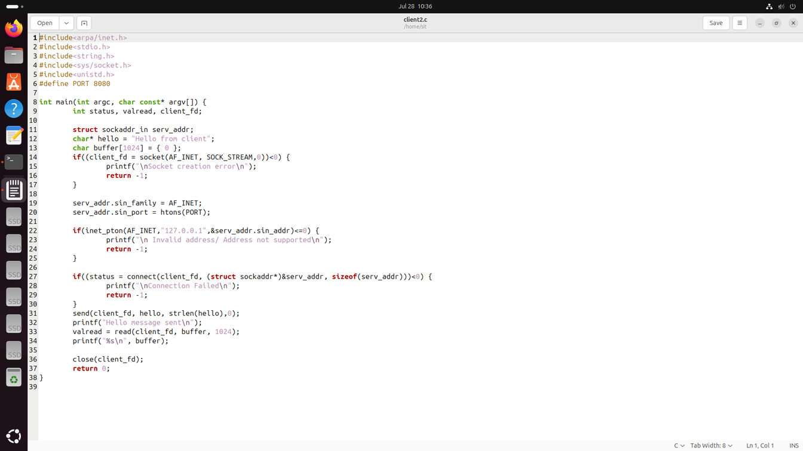
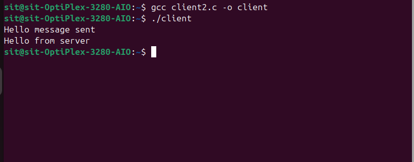

# Practical 03: Socket Programming for TCP Client

## 📌 Aim
To implement socket programming for a TCP (Transmission Control Protocol) Client in C language on a Linux environment, establish an active connection to a running TCP server via IP address and port, send a message, receive the server's reply, and gracefully terminate.

---

## 📖 Theory & Socket Fundamentals

### 1. TCP Client Architecture
Unlike a TCP server (which listens passively and awaits connections), a TCP client acts as an active initiator. It initiates the three-way handshake (`SYN`) to request a session with the target server.

### 2. TCP Client Socket Lifecycle
1. `socket()`: Allocates an endpoint for communication using domain `AF_INET` and type `SOCK_STREAM`.
2. `inet_pton()`: Converts the human-readable IPv4 text representation (e.g., `"127.0.0.1"`) into binary form in network byte order and stores it in `serv_addr.sin_addr`.
3. `connect()`: Initiates the TCP three-way handshake to establish a connection with the server specified by `serv_addr` on port `8080`.
4. `send()` / `write()`: Transmits the payload buffer (`"Hello from client"`) across the full-duplex stream.
5. `read()` / `recv()`: Reads the server's response (`"Hello from server"`) into the local buffer.
6. `close()`: Closes the client socket descriptor, sending a `FIN` packet to terminate the TCP connection.

---

## 💻 Source Code (`tcp_client.c`)

```c
#include <stdio.h>
#include <string.h>
#include <unistd.h>
#include <sys/socket.h>
#include <arpa/inet.h>

#define PORT 8080

int main(int argc, char const* argv[]) {
    int status, valread, client_fd;
    struct sockaddr_in serv_addr;
    char* hello = "Hello from client";
    char buffer[1024] = { 0 };

    // 1. Create socket file descriptor
    if ((client_fd = socket(AF_INET, SOCK_STREAM, 0)) < 0) {
        printf("\n Socket creation error \n");
        return -1;
    }

    // 2. Specify server IP and Port
    serv_addr.sin_family = AF_INET;
    serv_addr.sin_port = htons(PORT);

    // Convert IPv4 address from text to binary form
    if (inet_pton(AF_INET, "127.0.0.1", &serv_addr.sin_addr) <= 0) {
        printf("\n Invalid address/ Address not supported \n");
        return -1;
    }

    // 3. Connect to the remote TCP server
    if ((status = connect(client_fd, (struct sockaddr*)&serv_addr, sizeof(serv_addr))) < 0) {
        printf("\n Connection Failed \n");
        return -1;
    }

    // 4. Send greeting message to server
    send(client_fd, hello, strlen(hello), 0);
    printf("Hello message sent\n");

    // 5. Read response sent by server
    valread = read(client_fd, buffer, 1024);
    printf("%s\n", buffer);

    // 6. Close the connection socket
    close(client_fd);
    return 0;
}
```

---

## ⚙️ Compilation & Execution

```bash
# Compile the TCP Client
gcc tcp_client.c -o client

# Ensure the TCP server (from Practical 02) is already running in another terminal:
# ./server

# Run the TCP Client
./client
```

---

## 📸 Output & Screenshots

### 1. TCP Client Source Code in Editor (`client2.c`)


### 2. TCP Client Execution Output in Terminal


*Execution Flow Observed:*
1. The client compiles cleanly using `gcc client2.c -o client`.
2. Executing `./client` connects to loopback address `127.0.0.1` on port `8080`.
3. Client prints `"Hello message sent"`.
4. Client receives response from server: `"Hello from server"` and closes connection.

---

## 🎯 Conclusion
The TCP client was implemented and executed against the TCP server. The connection establishment via `connect()` succeeded, and bi-directional message exchange over reliable stream sockets was verified.
