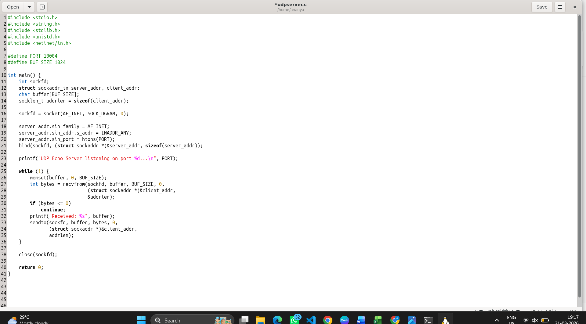
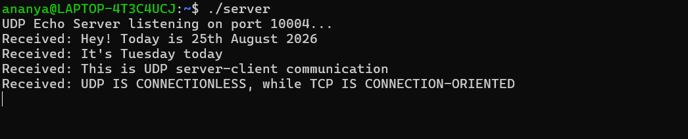

# Practical 04: Socket Programming for UDP Server

## 📌 Aim
To implement socket programming for a UDP (User Datagram Protocol) Echo Server in C language on a Linux environment, bind it to a UDP port, receive datagrams from clients without connection establishment, and echo the datagrams back.

---

## 📖 Theory & Socket Fundamentals

### 1. User Datagram Protocol (UDP)
UDP is a connectionless, lightweight transport layer protocol (OSI Layer 4). Key characteristics:
- **Connectionless**: No handshaking (`SYN` / `ACK`) is performed prior to data transmission.
- **Unreliable**: No built-in guarantee of delivery, packet ordering, or duplicate protection.
- **Message-Oriented**: Transmits data in discrete datagram packets; preservation of packet boundaries.
- **Low Overhead**: Header size is only 8 bytes (compared to TCP's minimum 20 bytes), making it ideal for real-time applications (DNS, VoIP, video streaming, online gaming).

### 2. UDP Server Socket Lifecycle
1. `socket()`: Creates a datagram socket using `SOCK_DGRAM` and `AF_INET`.
2. `bind()`: Binds the socket descriptor to local IP (`INADDR_ANY`) and port `10004`.
3. `recvfrom()`: Blocks waiting for an incoming datagram from any client. Captures both the message content and the client's network address (`struct sockaddr_in client_addr`).
4. `sendto()`: Sends the response datagram directly back to the address and port discovered in `client_addr`.
5. Loop continues to serve multiple client datagrams without maintaining session state.

---

## 💻 Source Code (`udp_server.c`)

```c
#include <stdio.h>
#include <string.h>
#include <stdlib.h>
#include <unistd.h>
#include <netinet/in.h>

#define PORT 10004
#define BUF_SIZE 1024

int main() {
    int sockfd;
    struct sockaddr_in server_addr, client_addr;
    char buffer[BUF_SIZE];
    socklen_t addrlen = sizeof(client_addr);

    // 1. Create UDP socket (SOCK_DGRAM)
    sockfd = socket(AF_INET, SOCK_DGRAM, 0);

    // 2. Configure server address structure
    server_addr.sin_family = AF_INET;
    server_addr.sin_addr.s_addr = INADDR_ANY;
    server_addr.sin_port = htons(PORT);

    // 3. Bind socket to port
    bind(sockfd, (struct sockaddr *)&server_addr, sizeof(server_addr));

    printf("UDP Echo Server listening on port %d...\n", PORT);

    // 4. Server Loop: Receive and echo datagrams
    while (1) {
        memset(buffer, 0, BUF_SIZE);
        int bytes = recvfrom(sockfd, buffer, BUF_SIZE, 0,
                             (struct sockaddr *)&client_addr,
                             &addrlen);
        if (bytes <= 0)
            continue;

        printf("Received: %s", buffer);

        // Echo the packet back to the sender
        sendto(sockfd, buffer, bytes, 0,
               (struct sockaddr *)&client_addr,
               addrlen);
    }

    close(sockfd);
    return 0;
}
```

---

## ⚙️ Compilation & Execution

```bash
# Compile the UDP Server
gcc udp_server.c -o server

# Run the UDP Server
./server
```

---

## 📸 Output & Screenshots

### 1. UDP Server Source Code in Editor (`udpserver.c`)


### 2. UDP Server Execution Output in Terminal


*Execution Flow Observed:*
1. The server starts listening on UDP port `10004`.
2. As the client sends messages, the server receives and displays them in real-time:
   - `Received: Hey! Today is 25th August 2026`
   - `Received: It's Tuesday today`
   - `Received: This is UDP server-client communication`
   - `Received: UDP IS CONNECTIONLESS, while TCP IS CONNECTION-ORIENTED`
3. Each received message is immediately echoed back to the client.

---

## 🎯 Conclusion
The UDP Echo Server was implemented and tested. Because UDP is connectionless, the server operates without calling `listen()` or `accept()`, receiving datagrams directly through `recvfrom()` and replying via `sendto()`.
