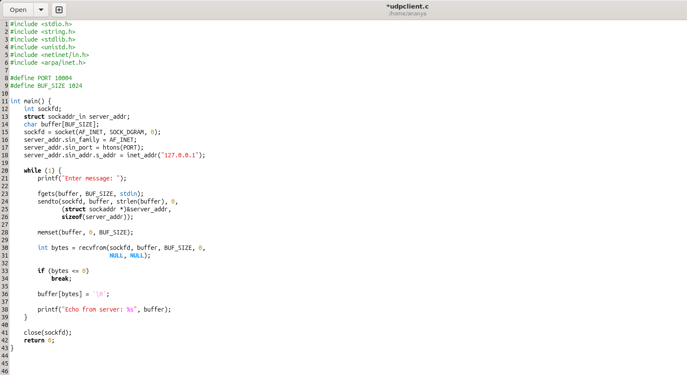
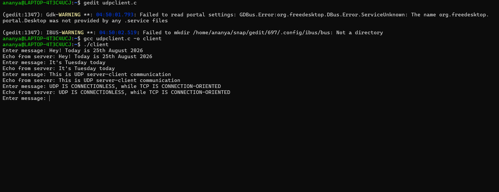

# Practical 05: Socket Programming for UDP Client

## 📌 Aim
To implement socket programming for a UDP (User Datagram Protocol) Client in C language on a Linux environment, send user input messages as datagrams to the UDP server, receive the echoed messages, and display them.

---

## 📖 Theory & Socket Fundamentals

### 1. UDP Client Operation
In UDP communication, the client does not establish a persistent connection with the server before transmitting. Instead:
- It creates a socket of type `SOCK_DGRAM`.
- It populates a `struct sockaddr_in` with the destination server's IP address and port.
- Each call to `sendto()` encapsulates the data into an independent UDP datagram specifying the target address.
- `recvfrom()` awaits the datagram response from the network.

### 2. Differences Between TCP and UDP Client
| Feature | TCP Client | UDP Client |
|---|---|---|
| **Socket Type** | `SOCK_STREAM` | `SOCK_DGRAM` |
| **Connection Method** | `connect()` required | No `connect()` required |
| **Data Transmission** | `send()` / `write()` | `sendto()` with destination address |
| **Data Reception** | `recv()` / `read()` | `recvfrom()` |
| **Delivery Guarantee** | Acknowledged & retransmitted | Unacknowledged best-effort |

---

## 💻 Source Code (`udp_client.c`)

```c
#include <stdio.h>
#include <string.h>
#include <stdlib.h>
#include <unistd.h>
#include <netinet/in.h>
#include <arpa/inet.h>

#define PORT 10004
#define BUF_SIZE 1024

int main() {
    int sockfd;
    struct sockaddr_in server_addr;
    char buffer[BUF_SIZE];

    // 1. Create UDP socket (SOCK_DGRAM)
    sockfd = socket(AF_INET, SOCK_DGRAM, 0);

    // 2. Configure target server address
    server_addr.sin_family = AF_INET;
    server_addr.sin_port = htons(PORT);
    server_addr.sin_addr.s_addr = inet_addr("127.0.0.1");

    // 3. User interaction loop
    while (1) {
        printf("Enter message: ");
        if (fgets(buffer, BUF_SIZE, stdin) == NULL)
            break;

        // Send datagram directly to destination server
        sendto(sockfd, buffer, strlen(buffer), 0,
               (struct sockaddr *)&server_addr,
               sizeof(server_addr));

        // Receive echoed datagram
        memset(buffer, 0, BUF_SIZE);
        int bytes = recvfrom(sockfd, buffer, BUF_SIZE, 0,
                             NULL, NULL);
        if (bytes <= 0)
            break;

        buffer[bytes] = '\0';
        printf("Echo from server: %s", buffer);
    }

    // 4. Close socket
    close(sockfd);
    return 0;
}
```

---

## ⚙️ Compilation & Execution

```bash
# Compile the UDP Client
gcc udp_client.c -o client

# Run the UDP Client (make sure UDP server is running)
./client
```

---

## 📸 Output & Screenshots

### 1. UDP Client Source Code in Editor (`udpclient.c`)


### 2. UDP Client Execution Output in Terminal


*Execution Flow Observed:*
1. Compiled using `gcc udpclient.c -o client`.
2. Running `./client` enters interactive prompt:
   - Input: `Hey! Today is 25th August 2026` -> Output: `Echo from server: Hey! Today is 25th August 2026`
   - Input: `It's Tuesday today` -> Output: `Echo from server: It's Tuesday today`
   - Input: `This is UDP server-client communication` -> Output: `Echo from server: This is UDP server-client communication`
   - Input: `UDP IS CONNECTIONLESS, while TCP IS CONNECTION-ORIENTED` -> Output: `Echo from server: UDP IS CONNECTIONLESS, while TCP IS CONNECTION-ORIENTED`

---

## 🎯 Conclusion
The UDP client program successfully communicated with the UDP echo server using connectionless datagram transmission. The preservation of packet content and rapid round-trip delivery without handshaking overhead was observed.
