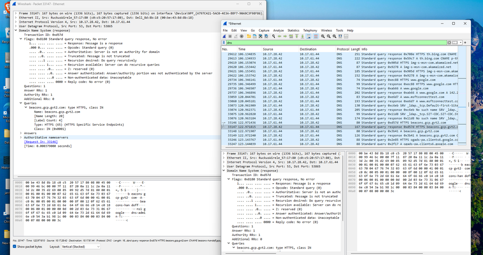
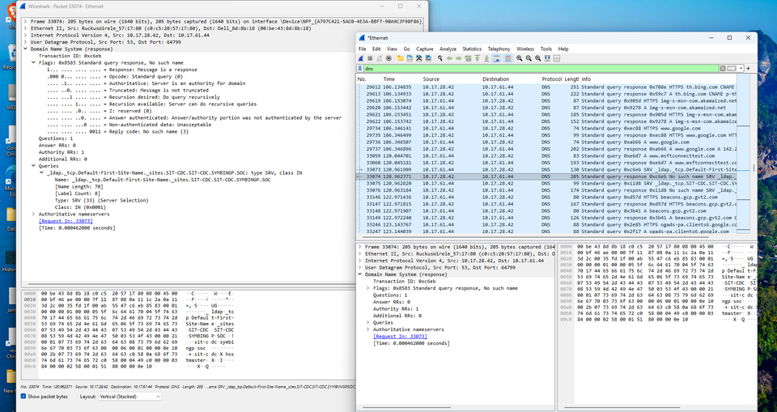

# Practical 06: Analysis of Application Layer Packets using DNS Commands & Packet Analyzer

## 📌 Aim
To analyze Domain Name System (DNS) application layer packets using command-line diagnostic utilities (`nslookup`, `dig`, `host`) and perform detailed packet inspection using a packet analyzer (Wireshark / Cisco Packet Tracer) to examine DNS query/response structures, transaction IDs, header flags, and resource records.

---

## 📖 Theory & Fundamentals

### 1. Domain Name System (DNS)
DNS is a core Application Layer protocol (OSI Layer 7) that translates human-friendly alphanumeric domain names (e.g., `google.com`) into machine-routable IP addresses (e.g., `142.250.183.174`).
- **Default Port**: Port 53.
- **Transport Layer**: Primarily utilizes **UDP** for fast, lightweight standard queries and responses (< 512 bytes). Uses **TCP** for zone transfers (AXFR) and EDNS0 responses exceeding UDP buffer sizes.

### 2. DNS Hierarchical Architecture
```
                   . (Root Level)
            /        |        \
          .com      .org      .edu (Top-Level Domains - TLD)
         /    \
     google  example (Second-Level Domains)
      /
    www / beacons (Subdomains / Hostnames)
```

### 3. DNS Message Format
Every DNS packet shares a unified structure:
1. **Identification (Transaction ID)**: A 16-bit identifier matched between request and response to prevent spoofing.
2. **Flags (16 bits)**:
   - `QR` (Query/Response flag): 0 = Query, 1 = Response.
   - `Opcode` (4 bits): 0 = Standard Query.
   - `AA` (Authoritative Answer): 1 = Server is authoritative for domain.
   - `TC` (Truncation flag): 1 = Message was truncated (> 512 bytes).
   - `RD` (Recursion Desired): 1 = Client requests recursive resolution.
   - `RA` (Recursion Available): 1 = Server supports recursion.
   - `RCODE` (Response Code, 4 bits): 0 = No error, 3 = Name Error (NXDOMAIN).
3. **Questions Count & Section**: Domain name queried, Query Type (A, AAAA, MX, NS, SRV, HTTPS), and Class (IN = Internet).
4. **Answer Resource Records (RRs)**: Resolved IP addresses or aliases.
5. **Authority Resource Records**: Authoritative nameservers.
6. **Additional Resource Records**: Glue records, EDNS0 options.

---

## 🛠️ DNS Command Line Exploration (`dns_commands.sh`)

### 1. `nslookup` (Name Server Lookup)
```bash
# Basic A-record lookup
nslookup google.com

# Query specific Record Type (e.g., Mail Exchanger MX)
nslookup -type=mx google.com

# Query using a specific DNS Server (e.g., Google DNS 8.8.8.8)
nslookup google.com 8.8.8.8
```

### 2. `dig` (Domain Information Groper)
```bash
# Standard lookup with answer section
dig google.com +short

# Full trace from root servers to authoritative servers
dig google.com +trace
```

### 3. `host` Command
```bash
# Simple resolution
host google.com
```

---

## 📸 Packet Analysis & Wireshark Dissection

The captured DNS traffic was inspected using Wireshark with display filter `dns`:

### 1. DNS Standard Query Response (Frame 33147)


*Dissection Details Observed:*
- **Frame**: 33147 (167 bytes captured on wire).
- **Protocols**: Ethernet II -> IPv4 (`Src: 10.17.28.42`, `Dst: 10.17.61.44`) -> UDP (`Src Port: 53`, `Dst Port: 53865`) -> DNS.
- **Transaction ID**: `0xd57d`.
- **Flags**: `0x8180` Standard query response, No error:
  - `Response: Message is a response (1)`
  - `Opcode: Standard query (0)`
  - `Authoritative: Server is not an authority for domain (0)`
  - `Truncated: Message is not truncated (0)`
  - `Recursion desired: Do query recursively (1)`
  - `Recursion available: Server can do recursive queries (1)`
  - `Reply code: No error (0)`
- **Queries**: `beacons.gcp.gvt2.com`: type `HTTPS (65)`, class `IN (0x0001)`.
- **Answers**: Resolved CNAME / HTTPS record.

---

### 2. DNS Standard Query Response - Non-Existent Domain (Frame 33074)


*Dissection Details Observed:*
- **Frame**: 33074 (205 bytes captured on wire).
- **Transaction ID**: `0xc6eb`.
- **Flags**: `0x8583` Standard query response, No such name:
  - `Response: Message is a response (1)`
  - `Recursion desired: Do query recursively (1)`
  - `Recursion available: Server can do recursive queries (1)`
  - `Reply code: No such name (3)` (**NXDOMAIN**).
- **Queries**: `_ldap._tcp.Default-First-Site-Name._sites.SIT-CDC.SIT-CDC.SYMBINOP.SOC`: type `SRV (33)`, class `IN`.
- Demonstrates how the DNS resolver signals that a requested service record does not exist.

---

## 🔬 Cisco Packet Tracer DNS Analysis Procedure
1. Create a topology with 1 PC, 1 Switch (2960), and 1 Server (DNS Server).
2. Connect devices via Straight-Through copper Ethernet cables.
3. Configure PC IP: `192.168.1.10`, Subnet: `255.255.255.0`, DNS Server: `192.168.1.1`.
4. Configure Server IP: `192.168.1.1`, enable DNS Service under **Services -> DNS**.
5. Add an A Record: `www.example.com` -> `192.168.1.1`.
6. Switch to **Simulation Mode**, enter `nslookup www.example.com` on PC Command Prompt, and inspect outbound DNS UDP datagram on port 53.

---

## 🎯 Conclusion
DNS application layer packets were analyzed using command-line diagnostic tools and packet analyzers. The inspection of captured frames confirmed the structure of DNS headers, transaction IDs, flag bits (query vs response, recursion, reply codes), and resource record parsing.
