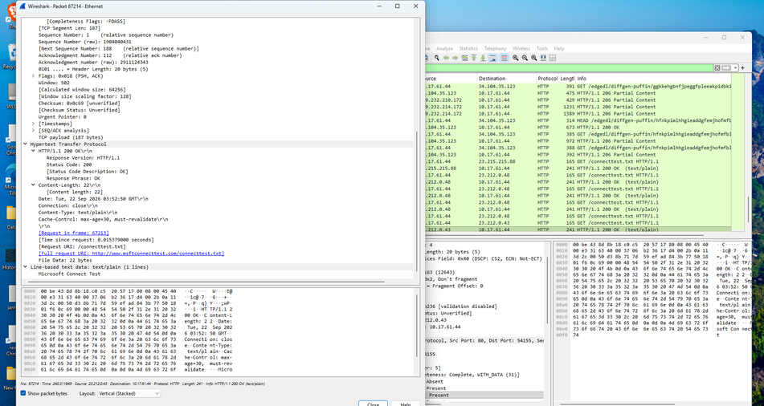
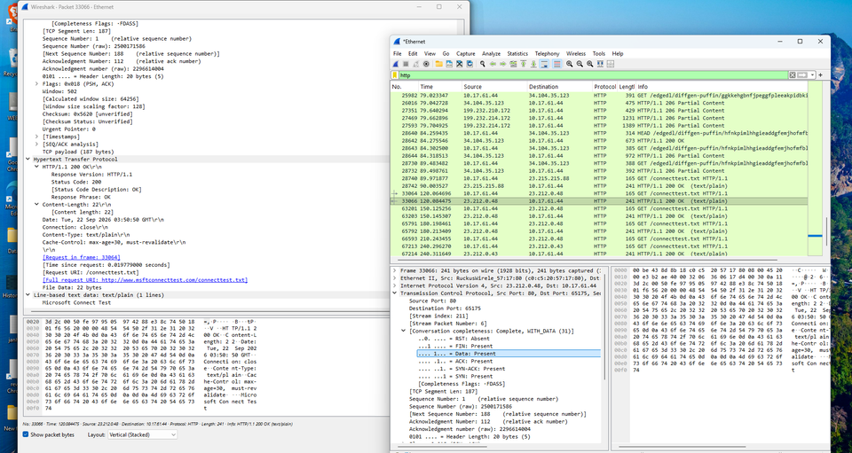

# Practical 07: Analysis of Application Layer Packets using HTTP Commands & Packet Analyzer

## 📌 Aim
To analyze Hypertext Transfer Protocol (HTTP) application layer packets using HTTP command-line tools (`curl`, `wget`) and perform detailed packet inspection using a packet analyzer (Wireshark / Cisco Packet Tracer) to analyze HTTP requests, status codes, header fields, and TCP stream assembly.

---

## 📖 Theory & Fundamentals

### 1. Hypertext Transfer Protocol (HTTP)
HTTP is an application-level, stateless, client-server protocol (OSI Layer 7) used for distributed, collaborative, hypermedia information systems.
- **Default Port**: TCP Port 80 (HTTP) / Port 443 (HTTPS).
- **Transport Protocol**: TCP (guarantees ordered, lossless delivery through connection handshake).
- **Stateless Nature**: Each request is independent; state is preserved using cookies, sessions, or tokens.

### 2. HTTP Request & Response Cycle
1. **Client Request**:
   - **Request Line**: `METHOD URI HTTP-VERSION` (e.g., `GET /connecttest.txt HTTP/1.1`).
   - **Headers**: Key-value pairs providing metadata (`Host`, `User-Agent`, `Accept`, `Connection`).
   - **Empty Line (`\r\n`)**: Separates headers from message body.
   - **Optional Body**: Payload data for `POST` or `PUT`.
2. **Server Response**:
   - **Status Line**: `HTTP-VERSION STATUS-CODE REASON-PHRASE` (e.g., `HTTP/1.1 200 OK`).
   - **Headers**: Response metadata (`Content-Type`, `Content-Length`, `Date`, `Server`, `Cache-Control`).
   - **Empty Line (`\r\n`)**.
   - **Response Body**: HTML, JSON, or raw text content.

### 3. HTTP Status Codes
| Code Range | Category | Common Examples |
|---|---|---|
| **1xx** | Informational | `100 Continue` |
| **2xx** | Success | `200 OK`, `206 Partial Content` |
| **3xx** | Redirection | `301 Moved Permanently`, `302 Found` |
| **4xx** | Client Error | `400 Bad Request`, `403 Forbidden`, `404 Not Found` |
| **5xx** | Server Error | `500 Internal Server Error`, `502 Bad Gateway` |

---

## 🛠️ HTTP Command Line Exploration (`http_commands.sh`)

```bash
# Fetch response headers only (HEAD request / inspect status code)
curl -I http://example.com

# Verbose output showing full request, TLS handshake, and response headers
curl -v http://example.com

# Request specific byte range (HTTP 206 Partial Content)
curl -I -H "Range: bytes=0-100" http://example.com

# Spidering and header inspection using wget
wget -S --spider http://example.com
```

---

## 📸 Packet Analysis & Wireshark Dissection

The captured HTTP traffic was analyzed using Wireshark with display filter `http`:

### 1. HTTP 200 OK Response & Entity Body Inspection (Frame 67214)


*Dissection Details Observed:*
- **Frame**: 67214 (241 bytes on wire).
- **Protocols**: Ethernet II -> IPv4 (`Src: 23.212.0.43`, `Dst: 10.17.61.44`) -> TCP (`Src Port: 80`, `Dst Port: 54155`) -> HTTP.
- **Status Line**: `HTTP/1.1 200 OK\r\n`:
  - `Response Version: HTTP/1.1`
  - `Status Code: 200`
  - `Response Phrase: OK`
- **Header Fields**:
  - `Content-Length: 22\r\n`
  - `Content-Type: text/plain\r\n`
  - `Connection: close\r\n`
  - `Cache-Control: max-age=30, must-revalidate\r\n`
  - `Date: Tue, 22 Sep 2026 03:52:50 GMT\r\n`
- **Request URI**: `http://www.msftconnecttest.com/connecttest.txt` (initiated in request frame 67213).
- **Line-Based Text Data**: `"Microsoft Connect Test"` (length: 22 bytes matching `Content-Length`).

---

### 2. HTTP Stream & Packet Exchange Tracking (Frame 33066)


*Dissection Details Observed:*
- **Frame**: 33066 (241 bytes on wire).
- **TCP Stream Index**: 211.
- **Flags**: `[PSH, ACK]`, `Window: 502`, `TCP Segment Len: 187`.
- **Traffic Overview**:
  - Multiple `GET` requests receiving `HTTP/1.1 206 Partial Content` and `HTTP/1.1 200 OK`.
  - Shows request-response latency: `[Time since request: 0.019779000 seconds]`.
  - Confirms reassembly of TCP byte stream into discrete HTTP application layer data.

---

## 🔬 Cisco Packet Tracer HTTP Analysis Procedure
1. Add a PC and a Web Server connected via a 2960 Switch.
2. Assign static IP addresses (PC: `192.168.1.10`, Server: `192.168.1.1`).
3. Under Server **Services -> HTTP**, turn HTTP **ON** and edit `index.html`.
4. Open the PC Desktop, launch **Web Browser**, and enter `http://192.168.1.1`.
5. In **Simulation Mode**, track the `TCP SYN` -> `SYN-ACK` -> `ACK` handshake followed by the `HTTP GET` request and `HTTP/1.1 200 OK` response packet.

---

## 🎯 Conclusion
The HTTP application layer protocol was analyzed through CLI tools and packet dissection. The inspection confirmed the structure of HTTP request and response headers, response codes (200 OK and 206 Partial Content), header delimiters (`\r\n`), content length calculations, and encapsulation over underlying TCP streams.
