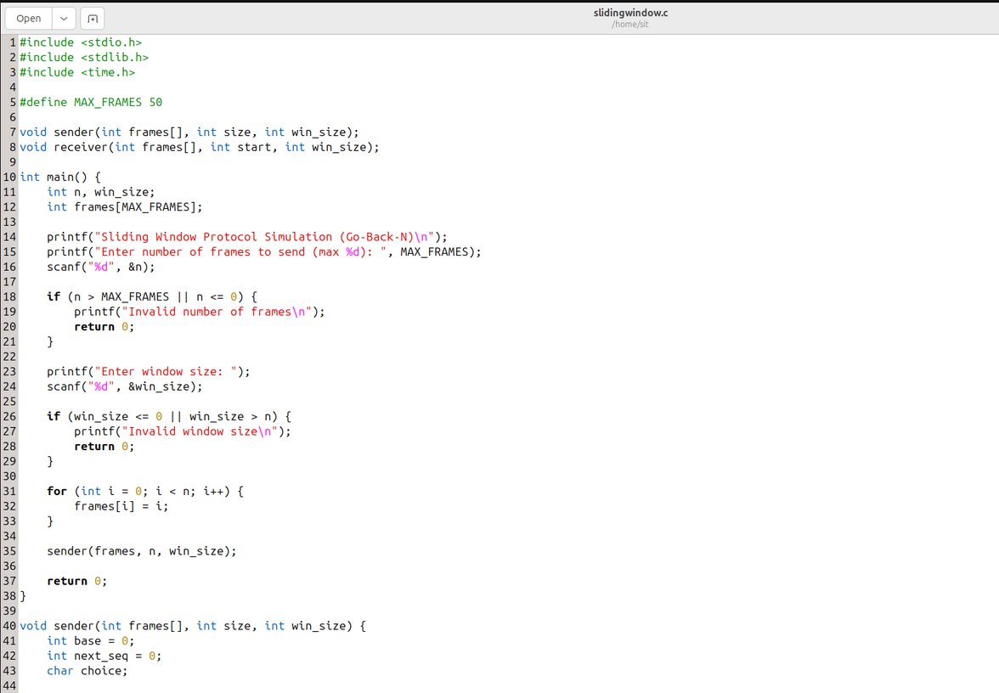
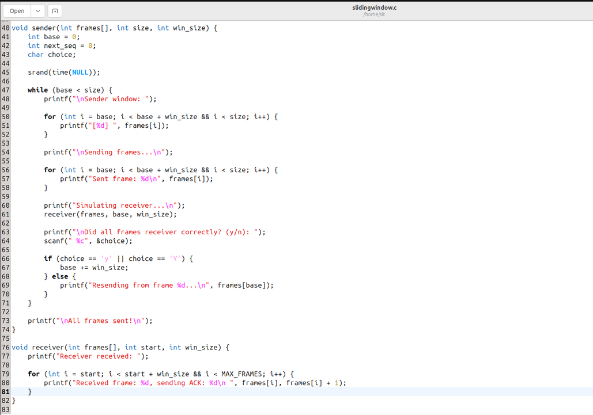
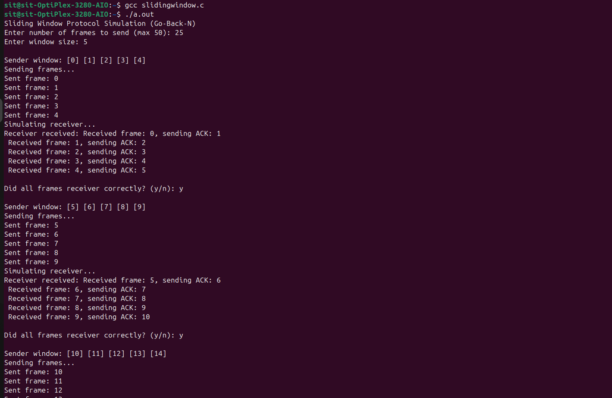
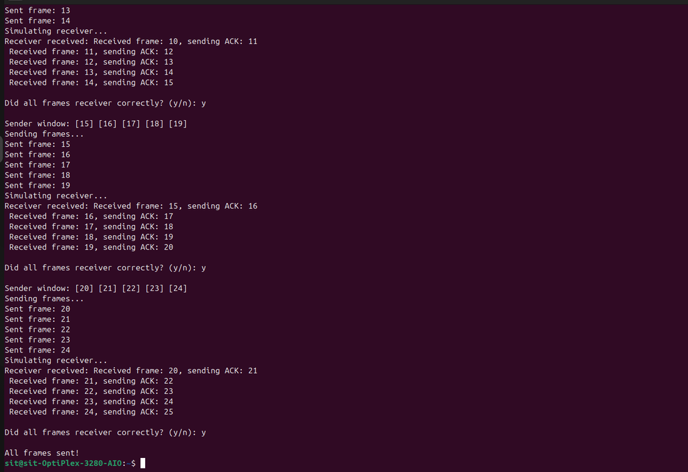

# Practical 08: Implementation of Sliding Window Protocol

## 📌 Aim
To simulate and implement the Sliding Window Protocol (specifically Go-Back-N ARQ) in C language, demonstrating pipelined frame transmission, window boundaries, receiver acknowledgments, and retransmission upon error.

---

## 📖 Theory & Fundamentals

### 1. Need for Sliding Window Protocols
In basic **Stop-and-Wait ARQ**, the sender transmits a single frame and remains idle until it receives an acknowledgment (`ACK`) from the receiver. In links with a high Bandwidth-Delay Product, the sender channel remains largely underutilized.
**Sliding Window Protocols** solve this by enabling **pipelining**: the sender transmits multiple frames up to a predefined window size ($W$) before needing an acknowledgment.

### 2. Go-Back-N (GBN) Protocol
- **Sender Window Size ($W$)**: Can transmit up to $W$ consecutive unacknowledged frames.
- **Sequence Numbers**: Assigned sequentially ($0, 1, 2, \dots, n-1$).
- **Cumulative Acknowledgment**: `ACK m` informs the sender that all frames up to $m-1$ have been received correctly.
- **Error Handling**: If a frame is lost, damaged, or its ACK fails:
  - The receiver discards all subsequent out-of-order frames.
  - The sender timer expires for the unacknowledged frame, and the sender **goes back** and retransmits all frames in the window starting from the lost frame (`base`).

### 3. Comparison of Flow Control Protocols
| Protocol | Sender Window Size ($W_s$) | Receiver Window Size ($W_r$) | Retransmission Scope | Efficiency |
|---|---|---|---|---|
| **Stop-and-Wait** | $1$ | $1$ | 1 frame | Lowest |
| **Go-Back-N** | $N$ | $1$ | All $N$ frames in current window | Moderate |
| **Selective Repeat** | $N$ | $N$ | Only individual corrupted/lost frame | Highest |

---

## 💻 Source Code (`sliding_window.c`)

```c
#include <stdio.h>
#include <stdlib.h>
#include <time.h>

#define MAX_FRAMES 50

void sender(int frames[], int size, int win_size);
void receiver(int frames[], int start, int win_size);

int main() {
    int n, win_size;
    int frames[MAX_FRAMES];

    printf("Sliding Window Protocol Simulation (Go-Back-N)\n");
    printf("Enter number of frames to send (max %d): ", MAX_FRAMES);
    scanf("%d", &n);

    if (n > MAX_FRAMES || n <= 0) {
        printf("Invalid number of frames\n");
        return 0;
    }

    printf("Enter window size: ");
    scanf("%d", &win_size);

    if (win_size <= 0 || win_size > n) {
        printf("Invalid window size\n");
        return 0;
    }

    for (int i = 0; i < n; i++) {
        frames[i] = i;
    }

    sender(frames, n, win_size);

    return 0;
}

void sender(int frames[], int size, int win_size) {
    int base = 0;
    char choice;

    while (base < size) {
        printf("\nSender window: ");
        for (int i = base; i < base + win_size && i < size; i++) {
            printf("[%d] ", frames[i]);
        }

        printf("\nSending frames...\n");
        for (int i = base; i < base + win_size && i < size; i++) {
            printf("Sent frame: %d\n", frames[i]);
        }

        printf("Simulating receiver...\n");
        receiver(frames, base, win_size);

        printf("\nDid all frames receiver correctly? (y/n): ");
        scanf(" %c", &choice);

        if (choice == 'y' || choice == 'Y') {
            base += win_size;
        } else {
            printf("Resending from frame %d...\n", frames[base]);
        }
    }

    printf("\nAll frames sent!\n");
}

void receiver(int frames[], int start, int win_size) {
    printf("Receiver received: ");
    for (int i = start; i < start + win_size && i < MAX_FRAMES; i++) {
        printf("Received frame: %d, sending ACK: %d\n", frames[i], frames[i] + 1);
    }
}
```

---

## ⚙️ Compilation & Execution

```bash
# Compile the Sliding Window program
gcc sliding_window.c -o sliding_window

# Run the simulation
./sliding_window
```

---

## 📸 Output & Screenshots

### 1. Sliding Window Source Code in Editor (`slidingwindow.c`)



### 2. Sliding Window Simulation Output in Terminal



*Execution Flow Observed:*
1. Input: Number of frames = `25`, Window size = `5`.
2. **Iteration 1**: Window `[0] [1] [2] [3] [4]`.
   - Sent frames `0, 1, 2, 3, 4`.
   - Receiver sends ACKs `1, 2, 3, 4, 5`.
   - Successful acknowledgment moves the window base to `5`.
3. **Iteration 2**: Window `[5] [6] [7] [8] [9]`.
   - Receiver acknowledges, window advances to `10`.
4. Process repeats iteratively until Window `[20] [21] [22] [23] [24]` is transmitted and acknowledged.
5. Final confirmation: `"All frames sent!"`.

---

## 🎯 Conclusion
The Go-Back-N Sliding Window protocol was simulated in C. The experiment demonstrated how pipelined frame transmission improves link throughput compared to Stop-and-Wait and illustrated how sender windows advance upon reception of acknowledgments.
