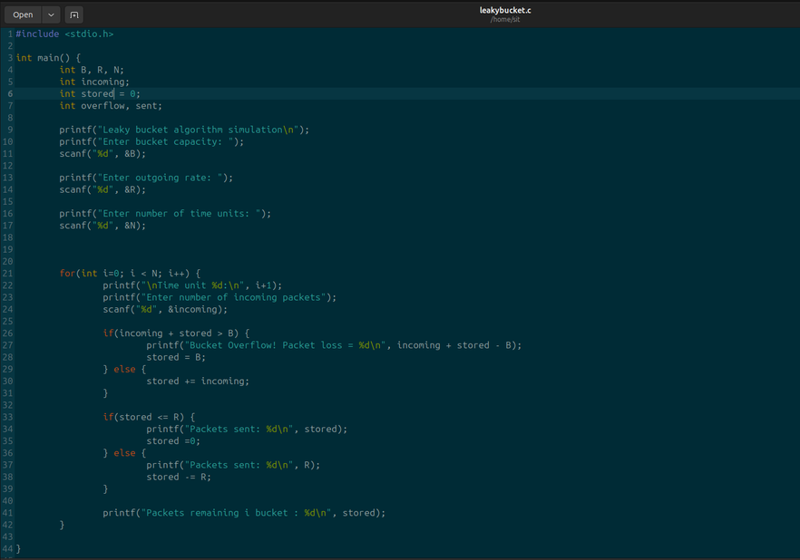
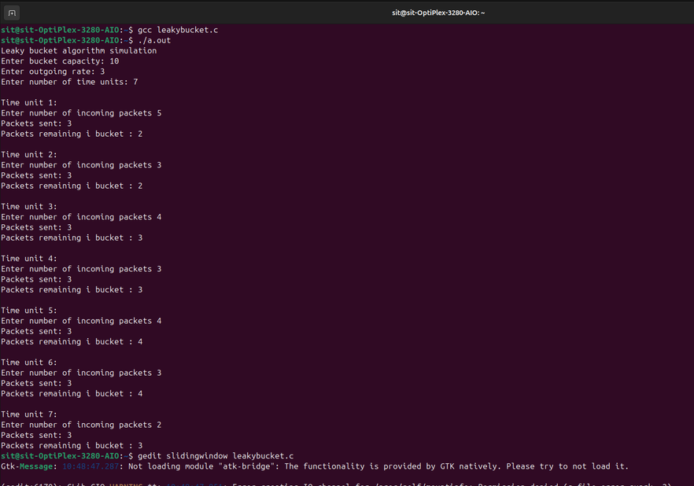
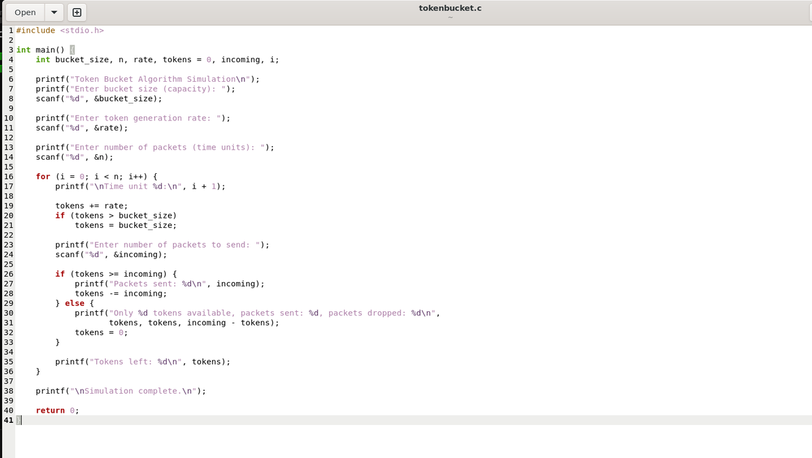
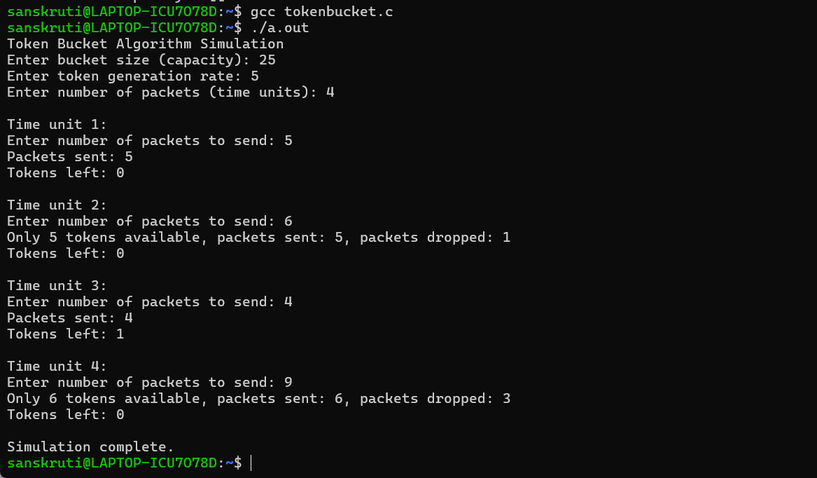

# Practical 09: Implementation of Traffic Shaping Algorithms (Leaky Bucket & Token Bucket)

## 📌 Aim
To implement and compare Traffic Shaping algorithms—specifically the **Leaky Bucket Algorithm** and the **Token Bucket Algorithm**—in C language to regulate bursty network traffic and enforce traffic policing.

---

## 📖 Theory & Fundamentals

### 1. Traffic Shaping & Congestion Control
In computer networks, traffic generated by applications is often bursty (e.g., video streaming, web downloads). If bursty traffic enters the network unconstrained, it causes buffer overflow in intermediate routers and severe packet loss.
**Traffic Shaping** is a mechanism that regulates the average rate and burstiness of data packets entering the network.

---

### 2. Leaky Bucket Algorithm
- **Concept**: Imagine a bucket with a small hole in the bottom. No matter what rate water (packets) pours into the bucket, water leaks out at a constant, uniform rate.
- **Mechanism**:
  - The bucket has a finite capacity $B$.
  - Incoming packets enter the bucket buffer.
  - If the incoming volume exceeds available bucket capacity, the excess packets are discarded (**overflow / packet loss**).
  - Packets leave the bucket at a **constant fixed rate $R$** per time unit.
- **Output**: Produces a strictly smooth, uniform stream of packets.

---

### 3. Token Bucket Algorithm
- **Concept**: A bucket holds tokens that are replenished at a constant rate $R$ up to a maximum bucket capacity $B$.
- **Mechanism**:
  - Tokens are continuously added to the bucket at rate $R$ per time unit.
  - Excess tokens beyond bucket capacity are discarded (tokens spill, not packets).
  - To transmit a packet, an equivalent number of tokens must be removed from the bucket.
  - If sufficient tokens exist, packets are transmitted immediately (allowing controlled bursts).
  - If insufficient tokens exist, packets must either wait or be dropped.
- **Output**: Allows short-term **bursty traffic** up to the accumulated token limit, while bounding the long-term average transmission rate.

---

### 4. Comparison: Leaky Bucket vs Token Bucket
| Feature | Leaky Bucket Algorithm | Token Bucket Algorithm |
|---|---|---|
| **Output Rate** | Strictly constant, regardless of input burstiness | Bursty output permitted up to accumulated tokens |
| **Discards** | Discards packets when bucket capacity is full | Discards unused tokens when bucket is full |
| **Idle Periods** | Idle time cannot save bandwidth for later bursts | Tokens accumulate during idle periods for future bursts |
| **Suitability** | Strictly regulated circuits (ATM, real-time audio) | Burst-tolerant traffic (IP networks, HTTP, file transfers) |

---

## 💻 Source Code

### Part A: Leaky Bucket Algorithm (`leaky_bucket.c`)
```c
#include <stdio.h>

int main() {
    int B, R, N;
    int incoming;
    int stored = 0;

    printf("Leaky bucket algorithm simulation\n");
    printf("Enter bucket capacity: ");
    scanf("%d", &B);

    printf("Enter outgoing rate: ");
    scanf("%d", &R);

    printf("Enter number of time units: ");
    scanf("%d", &N);

    for (int i = 0; i < N; i++) {
        printf("\nTime unit %d:\n", i + 1);
        printf("Enter number of incoming packets ");
        scanf("%d", &incoming);

        // Check for bucket overflow
        if (incoming + stored > B) {
            printf("Bucket Overflow! Packet loss = %d\n", incoming + stored - B);
            stored = B;
        } else {
            stored += incoming;
        }

        // Transmit at fixed outgoing rate R
        if (stored <= R) {
            printf("Packets sent: %d\n", stored);
            stored = 0;
        } else {
            printf("Packets sent: %d\n", R);
            stored -= R;
        }

        printf("Packets remaining i bucket : %d\n", stored);
    }

    return 0;
}
```

---

### Part B: Token Bucket Algorithm (`token_bucket.c`)
```c
#include <stdio.h>

int main() {
    int bucket_size, n, rate, tokens = 0, incoming, i;

    printf("Token Bucket Algorithm Simulation\n");
    printf("Enter bucket size (capacity): ");
    scanf("%d", &bucket_size);

    printf("Enter token generation rate: ");
    scanf("%d", &rate);

    printf("Enter number of packets (time units): ");
    scanf("%d", &n);

    for (i = 0; i < n; i++) {
        printf("\nTime unit %d:\n", i + 1);

        // Generate tokens at constant rate
        tokens += rate;
        if (tokens > bucket_size)
            tokens = bucket_size;

        printf("Enter number of packets to send: ");
        scanf("%d", &incoming);

        // Check if sufficient tokens exist for transmission
        if (tokens >= incoming) {
            printf("Packets sent: %d\n", incoming);
            tokens -= incoming;
        } else {
            printf("Only %d tokens available, packets sent: %d, packets dropped: %d\n",
                   tokens, tokens, incoming - tokens);
            tokens = 0;
        }

        printf("Tokens left: %d\n", tokens);
    }

    printf("\nSimulation complete.\n");
    return 0;
}
```

---

## ⚙️ Compilation & Execution

```bash
# Compile and run Leaky Bucket
gcc leaky_bucket.c -o leaky
./leaky

# Compile and run Token Bucket
gcc token_bucket.c -o token
./token
```

---

## 📸 Output & Screenshots

### 1. Leaky Bucket Algorithm



*Leaky Bucket Run Analysis:*
- Capacity: `10`, Outgoing rate: `3`, Time units: `7`.
- When input exceeds leak rate (e.g., 5 incoming), only 3 packets are sent, and remaining 2 are stored.
- Packets leak out at a strictly uniform rate of 3 per interval.

---

### 2. Token Bucket Algorithm



*Token Bucket Run Analysis:*
- Capacity: `25`, Token generation rate: `5`, Time units: `4`.
- Time unit 1: 5 tokens generated, 5 packets requested -> 5 sent, 0 tokens left.
- Time unit 2: 5 tokens generated, 6 packets requested -> 5 sent, 1 packet dropped, 0 tokens left.
- Time unit 3: 5 tokens generated, 4 packets requested -> 4 sent, 1 token saved for next unit!
- Time unit 4: 1 + 5 = 6 tokens available, 9 packets requested -> 6 sent, 3 dropped.

---

## 🎯 Conclusion
Both Leaky Bucket and Token Bucket traffic shaping algorithms were implemented and evaluated in C. Leaky bucket enforces a smooth, constant output rate by buffering or discarding excess traffic, whereas token bucket allows controlled burst transmissions while enforcing an average rate limit.
