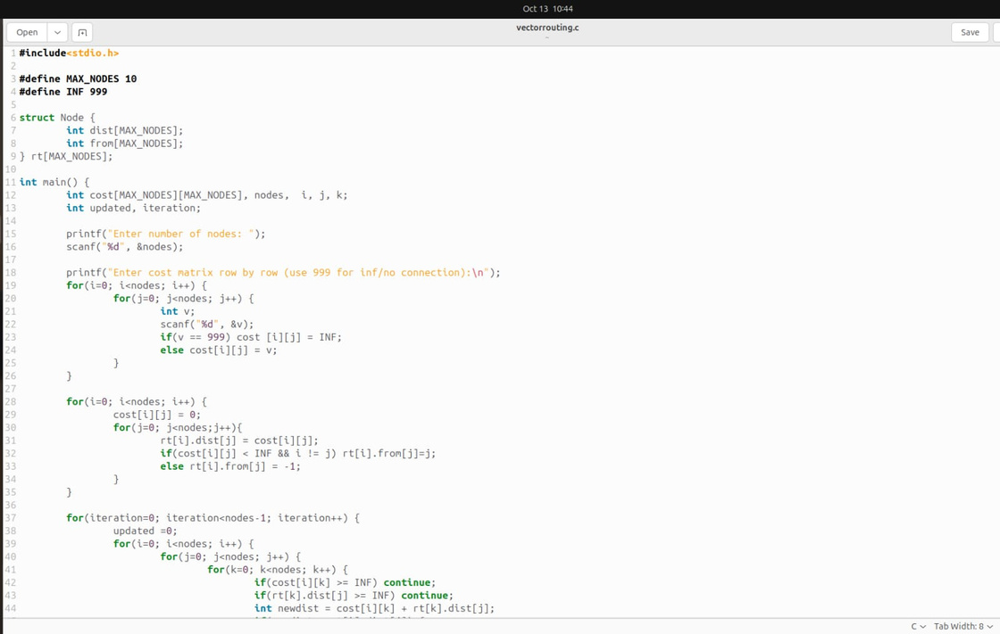
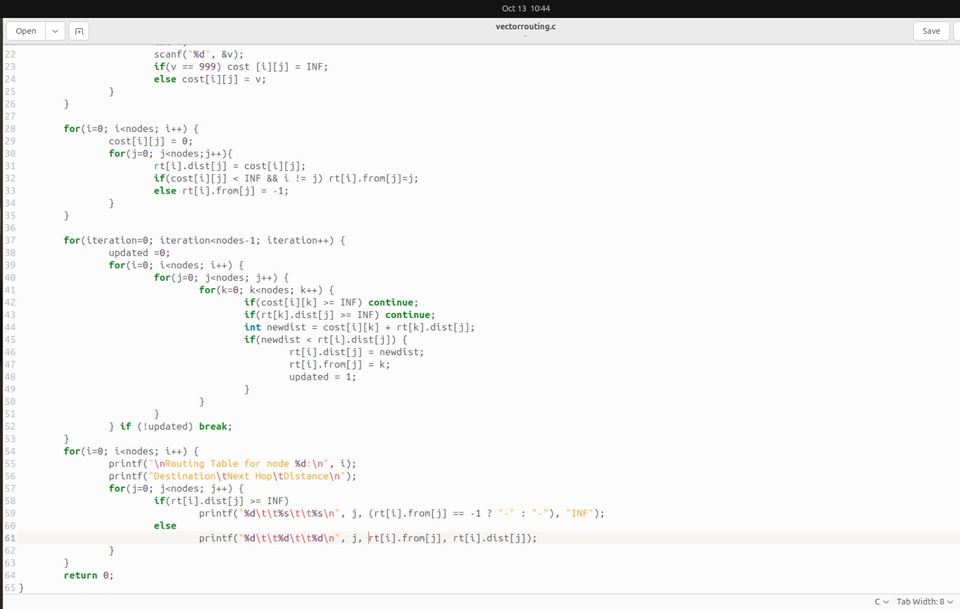
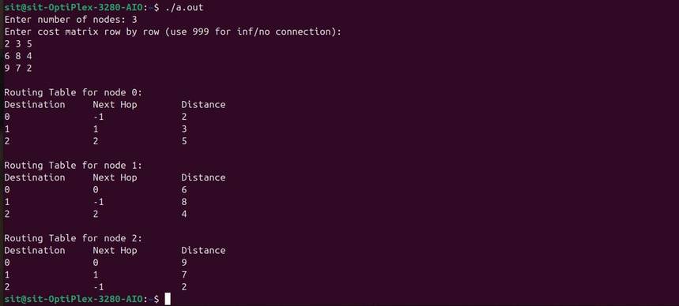

# Practical 10: Implementation of Distance Vector Routing Algorithm

## 📌 Aim
To implement the Distance Vector Routing Algorithm based on the **Bellman-Ford Algorithm** in C language, iteratively compute the shortest path routing table for every node in a network topology, and track the next-hop routers.

---

## 📖 Theory & Fundamentals

### 1. Routing in Computer Networks
Routing is the process of selecting paths across a network to deliver data packets from a source to a destination. Routing protocols are broadly classified into:
- **Link State Routing (e.g., OSPF)**: Each router floods information about its immediate neighbors to all routers; uses Dijkstra's algorithm.
- **Distance Vector Routing (e.g., RIP)**: Each router shares its known distance table with immediate neighbors only; uses the distributed **Bellman-Ford Algorithm**.

---

### 2. Distance Vector Routing Principles
1. **Distance Metric**: Typically measured in hop count or delay/link cost.
2. **Local Routing Table**: Every router maintains an array containing:
   - Target Destination node.
   - Shortest Distance (cost).
   - Next Hop router to reach that destination.
3. **Bellman-Ford Equation**:
   Let $D_x(y)$ be the cost of the least-cost path from node $x$ to node $y$. The distance vector update formula is:
   $$D_x(y) = \min_v \{ c(x, v) + D_v(y) \}$$
   where $c(x, v)$ is the direct link cost from $x$ to neighbor $v$, and $D_v(y)$ is neighbor $v$'s shortest distance to $y$.
4. **Convergence**: The iterative exchange of distance vectors continues across at most $N - 1$ rounds until no further updates occur (stable state).

---

## 💻 Source Code (`distance_vector.c`)

```c
#include <stdio.h>

#define MAX_NODES 10
#define INF 999

struct Node {
    int dist[MAX_NODES];
    int from[MAX_NODES];
} rt[MAX_NODES];

int main() {
    int cost[MAX_NODES][MAX_NODES], nodes, i, j, k;
    int updated, iteration;

    printf("Enter number of nodes: ");
    scanf("%d", &nodes);

    printf("Enter cost matrix row by row (use 999 for inf/no connection):\n");
    for (i = 0; i < nodes; i++) {
        for (j = 0; j < nodes; j++) {
            int v;
            scanf("%d", &v);
            if (v == 999) cost[i][j] = INF;
            else cost[i][j] = v;
        }
    }

    // Initialize routing table with direct link costs
    for (i = 0; i < nodes; i++) {
        cost[i][i] = 0;
        for (j = 0; j < nodes; j++) {
            rt[i].dist[j] = cost[i][j];
            if (cost[i][j] < INF && i != j) rt[i].from[j] = j;
            else rt[i].from[j] = -1;
        }
    }

    // Bellman-Ford shortest path iteration
    for (iteration = 0; iteration < nodes - 1; iteration++) {
        updated = 0;
        for (i = 0; i < nodes; i++) {
            for (j = 0; j < nodes; j++) {
                for (k = 0; k < nodes; k++) {
                    if (cost[i][k] >= INF) continue;
                    if (rt[k].dist[j] >= INF) continue;
                    int newdist = cost[i][k] + rt[k].dist[j];
                    if (newdist < rt[i].dist[j]) {
                        rt[i].dist[j] = newdist;
                        rt[i].from[j] = k;
                        updated = 1;
                    }
                }
            }
        }
        if (!updated) break;
    }

    // Display final routing table for each router node
    for (i = 0; i < nodes; i++) {
        printf("\nRouting Table for node %d:\n", i);
        printf("Destination\tNext Hop\tDistance\n");
        for (j = 0; j < nodes; j++) {
            if (rt[i].dist[j] >= INF)
                printf("%d\t\t-\t\tINF\n", j);
            else
                printf("%d\t\t%d\t\t%d\n", j, rt[i].from[j], rt[i].dist[j]);
        }
    }

    return 0;
}
```

---

## ⚙️ Compilation & Execution

```bash
# Compile Distance Vector Routing program
gcc distance_vector.c -o distance_vector

# Run the program
./distance_vector
```

---

## 📸 Output & Screenshots

### 1. Distance Vector Source Code in Editor (`vectorrouting.c`)



### 2. Distance Vector Execution Output in Terminal


*Execution Flow Observed:*
1. Input:
   - Number of nodes: `3`
   - Cost matrix:
     ```
     2 3 5
     6 8 4
     9 7 2
     ```
2. Resulting Routing Tables:
   - **Node 0**:
     - Dest `0`: Next Hop `-1`, Distance `2`
     - Dest `1`: Next Hop `1`, Distance `3`
     - Dest `2`: Next Hop `2`, Distance `5`
   - **Node 1**:
     - Dest `0`: Next Hop `0`, Distance `6`
     - Dest `1`: Next Hop `-1`, Distance `8`
     - Dest `2`: Next Hop `2`, Distance `4`
   - **Node 2**:
     - Dest `0`: Next Hop `0`, Distance `9`
     - Dest `1`: Next Hop `1`, Distance `7`
     - Dest `2`: Next Hop `-1`, Distance `2`

---

## 🎯 Conclusion
The Distance Vector Routing algorithm was successfully implemented in C. The Bellman-Ford algorithm dynamically calculated the minimum-cost paths and next-hop router entries for each node in the network topology.
